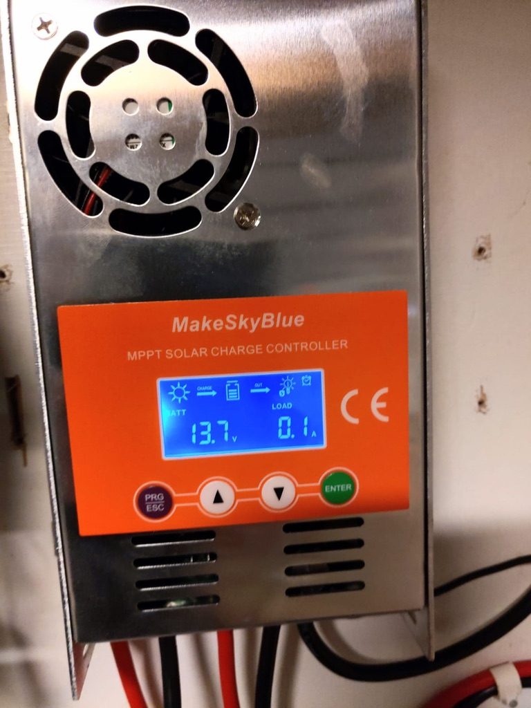
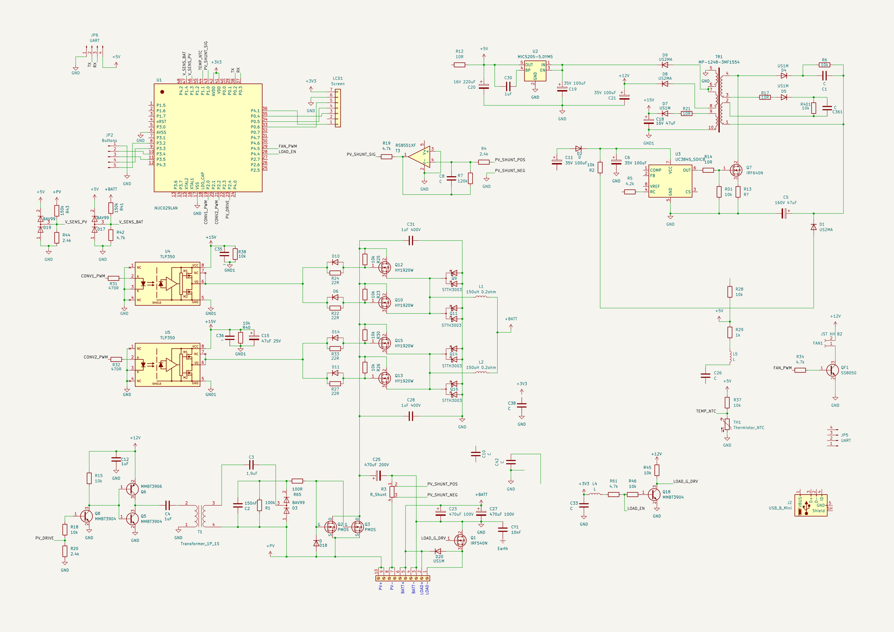
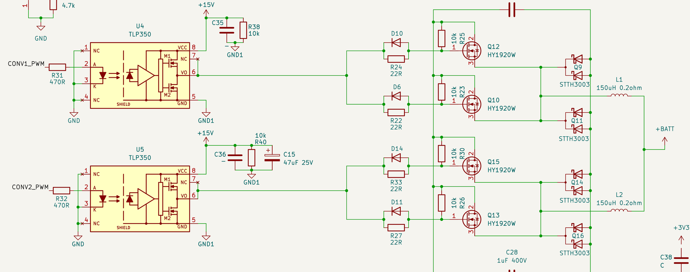
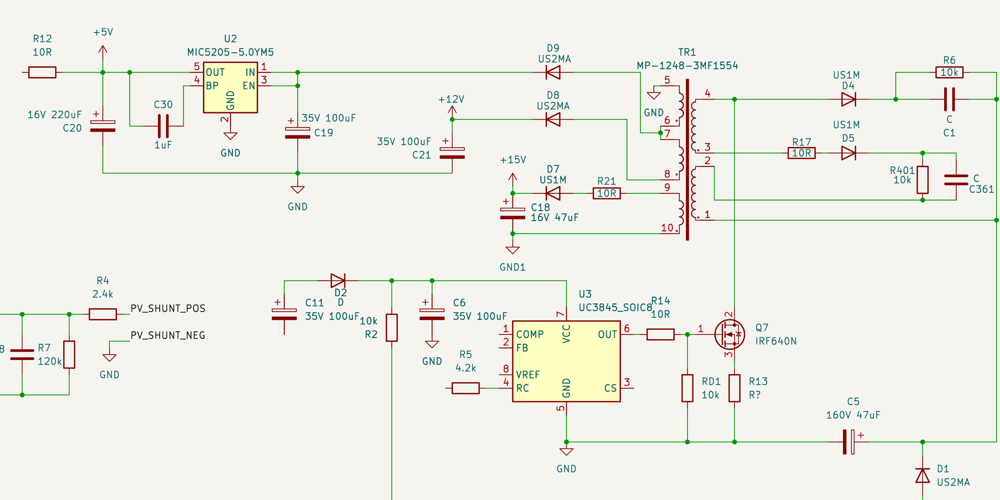
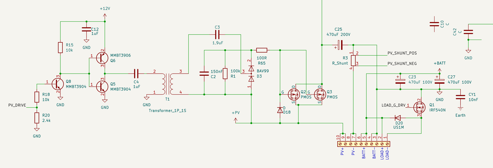
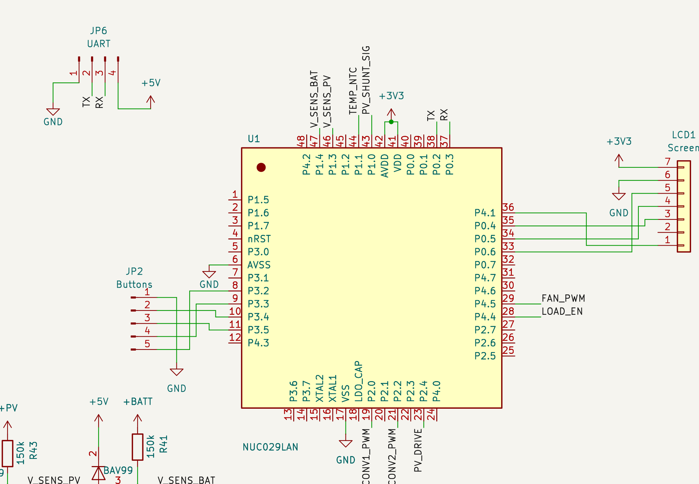

# Reverse engineering the MakeSkyBlue 60A MPPT

KiCad reverse-engineering of the MakeSkyBlue 60A MPPT solar charge controller, plus replacement ESP32 firmware for units with a dead NUC029 MCU.

## Schematic

| Power stage | Aux flyback supply |
|---|---|
|  |  |
| **PV input switch, shunt, terminals** | **MCU (NUC029LAN), buttons, LCD** |
|  |  |

To regenerate the images: `python3 tools/export_sch_images.py`

## Layout

| Path | Contents |
|---|---|
| `MakeSkyBlue-60A.kicad_*` | Schematic and PCB (KiCad 10) |
| `*.kicad_sym` + `sym-lib-table` | Project symbols: NUC029LAN, NUC120VE3DN, RS8551, TLP350, HY1920W |
| `Datasheets/` | Local only (git-ignored); download links in [`Datasheets/SOURCES.md`](Datasheets/SOURCES.md) |
| `replacement_esp32_firmware/` | ESP-IDF firmware for ESP32-C5-Zero + ST7789 TFT ([README](replacement_esp32_firmware/README.md)) |
| `tools/` | Python scripts that generate symbols, footprints and images |
| `pictures/` | Board photo, schematic images |

## Hardware notes

- **Power stage:** 4× HY1920W N-MOSFETs (200 V/90 A, TO-247) and 4× STTH3003 diodes, driven by TLP350 gate-drive optos.
- **Mounting:** every TO-220/TO-247 part sits on the back side, lying flat with the tab facing the heatsink. The footprints are `*_Horizontal_TabUp`; flip them to B.Cu in the PCB.
- **Aux supply:** UC3845 flyback through TR1 (custom transformer marked `MP-1248-3MF1554`; the symbol is a placeholder). It feeds the +15 V gate-driver rail, plus +12 V and +5 V.
